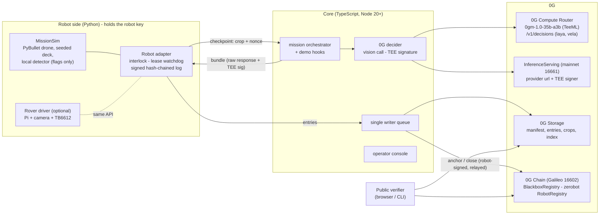

# Blackbox: 0G decides. Blackbox proves it.

**A decision recorder for autonomous inspection robots.** At every checkpoint the robot holds still and sends its camera crop to **0G's own sealed vision model** (`0gm-1.0-35b-a3b`, TeeML on Intel TDX). It moves **only** on an answer signed by an allowlisted 0G TEE signer that echoes its own nonce. Every decision goes into a robot-signed, keccak256-chained episode log on **0G Storage**, and the chain head is anchored on **0G Chain** every 2 decisions. If 0G is unreachable, the robot safe-stops and the log says *"0G unreachable, no decision made"*. It never guesses. Anyone can re-check a mission from one public link, and the mission can be **replayed** from its seed to the same trajectory hash.

Track: **Physical AI: Agents with a Body** (0G). Lane: robots and machines (sim drone), plus an optional real rover twin.

> Built on [zerobot](https://github.com/0gfoundation/zerobot): robots are identified by zerobot's `RobotRegistry`, and `BlackboxRegistry` checks `isOperator()` on it.

---

## Contents

1. [What the judges see (demo beats)](#what-the-judges-see)
2. [Qualification map](#qualification-map)
3. [Architecture](#architecture)
4. [Project structure](#project-structure)
5. [0G technology used](#0g-technology-used)
6. [Quick start: offline, no keys](#quick-start-offline-no-keys)
7. [Run on 0G testnet (Galileo)](#run-on-0g-testnet-galileo)
8. [Manual values checklist](#manual-values-checklist)
9. [Going to mainnet](#going-to-mainnet)
10. [Not yet verified against live 0G](#not-yet-verified-against-live-0g)
11. [Testing](#testing)
12. [Claims we make (and don't)](#claims-we-make-and-dont)
13. [Submission checklist](#submission-checklist)
14. [Deployment addresses](#deployment-addresses)
15. [Credits](#credits)

---

## What the judges see

The operator console (`http://127.0.0.1:8787`) has one button per beat.

| Beat | Judge does | What it shows | Console control |
|---|---|---|---|
| **1. Drop a crack** | Clicks the deck to place cracks and decoys (before or during flight) | The local detector flags **both**. 0G's sealed call flags the crack and rejects the decoy. The drone descends only on the crack. The card shows `request_id`, chat id, TEE signer ✔, binding, and the 0G Storage root | *Crack / Decoy* toggle, *Start mission* |
| **2. Split screen** | Watches | Same seed, same world, 0G's answers forced to "continue": the second drone flies past the crack. **0G's answer moved the robot** | *Split screen: force "continue"* |
| **3a. Forged decision** | Sends a forged "continue" from the operator console | The robot refuses: *"unsigned decision rejected: signer 0x… is not on the manifest allowlist"*. The refusal is logged | *Forge "continue"* |
| **3b. Tampered answer** | The core flips 0G's real answer but keeps 0G's real signature | The robot refuses: *"TEE signature does not cover this answer"*, asks 0G again, then acts on the genuine answer | *Tamper 0G answer* |
| **3c. Tampered log** | Lowers a severity in a local copy of the log | The verifier turns red and names the entry (*"Entry #2 (decision) was changed after the robot signed it"*) | *Edit log, verify* |
| **4. Kill switch** | Cuts the 0G link mid-mission (or kills the core) | The lease expires, the drone returns home, and the log reads *"0G unreachable, no decision made"*. There is no cached or local stand-in | *Cut 0G link*, *E-stop* |
| **5. Verify on your phone** | Scans the QR | The public verifier reads 0G Chain and 0G Storage **in the browser**: robot signatures, TEE signer, nonces, anchors, manifest, replay | *Verify on 0G*, *Public verifier*, *QR* |

---

## Qualification map

| 0G requirement | How Blackbox meets it | Where in the code |
|---|---|---|
| A 0G call inside the decision loop | At every checkpoint the robot holds, and `0gm-1.0-35b-a3b` (sealed, `X-0G-Provider-Trust-Mode: private`, `verify_tee: true`) classifies the crop and picks `descend`/`continue`. The path depends on the answer (beat 2). Optional **decision model** (`laya`/`vela-2.0-9b` on `/v1/decisions`) gives a calibrated hold | `core/src/zg/decide.ts`, `robot/blackbox_robot/mission.py` |
| Episode log on 0G Storage with a request id per decision | One canonical-JSON entry per event, uploaded with `MemData` via the turbo indexer. Each decision carries `x_0g_trace.request_id`, the chat id (`ZG-Res-Key`), provider, model, the raw response and the TEE signature, chained by keccak256 and signed by the robot key | `robot/blackbox_robot/episode_log.py`, `core/src/storage/index.ts`, `core/src/mission.ts` |
| Replayable simulation | PyBullet (DIRECT, 240 Hz) is re-run from the manifest seed plus the logged answers. Camera crops are re-rendered and compared by pixel hash, and the trajectory hash must match the one on chain | `robot/blackbox_robot/replay.py` |
| Safe stop if 0G is unreachable, never a faked decision | A lease watchdog in the robot adapter (3× median latency, capped at 12 s). Refused answers never extend the lease. The entry reads "0G unreachable, no decision made" | `robot/blackbox_robot/adapter.py` (`_watchdog`) |
| Not a chatbot / no pre-recorded motion / not just logs | No chat UI, and the model only sees frames and returns strict JSON. Motion is recomputed physics. The robot **refuses to act** without 0G's signature | `robot/blackbox_robot/interlock.py` |
| Contract addresses | `BlackboxRegistry` on Galileo (16602), plus zerobot's `RobotRegistry` it reads | [Deployment addresses](#deployment-addresses) |

---

## Architecture



**One checkpoint:**

```mermaid
sequenceDiagram
  participant S as Sim / rover
  participant A as Robot adapter
  participant C as Core
  participant R as 0G Router (TeeML)
  participant P as Provider broker (TEE)
  S->>A: detector flags a patch, robot HOLDS
  A->>A: nonce = keccak256(missionId, obs_hash, k), lease starts
  A->>C: POST /api/checkpoint {crop, nonce}
  C->>R: chat/completions, trust-mode private, verify_tee
  R-->>C: answer JSON + x_0g_trace.request_id + ZG-Res-Key
  C->>P: GET /v1/proxy/signature/{chatID}
  P-->>C: {text: "sha256(req):sha256(resp)", signature}
  C-->>A: bundle (exact response bytes + signature)
  A->>A: interlock: parses? nonce echoed? signer allowlisted? signature covers these bytes?
  alt all pass
    A->>S: actuate (descend / continue)
  else any fails
    A->>A: log "rejected", the lease keeps running
  end
  Note over A: lease expires with no valid answer: SAFE STOP, "0G unreachable, no decision made"
  A->>C: robot-signed log entry (motion never waits)
  C->>C: upload to 0G Storage; every 2 decisions: index + anchor on 0G Chain
```

**Why the robot can check what the core sends.** 0G's serving broker signs `sha256(request):sha256(response bytes)` with EIP-191 (from `0g-serving-broker` `ctrl/signing.go`). The core hands the robot the **exact** Router response bytes. The robot parses the answer from those bytes itself, rebuilds the bytes the broker signed, and checks the hash. A dishonest core cannot pair a real signature with a different answer (beat 3b), and cannot sign one itself (beat 3a).

---

## Project structure

```
.
├── README.md                    you are here
├── .env.example                 every setting; values you must fill are marked  <-- SET ME
├── package.json                 root scripts: setup, dev:local, test, robot, core, verify, probe, replay
├── scripts/dev-local.sh         one command: anvil + contracts + mock 0G + core + robot (offline)
│
├── contracts/                   Foundry, solc 0.8.27, evm cancun
│   ├── src/BlackboxRegistry.sol      register / anchor / close missions; robot-signed (EIP-191), relayable; zerobot isOperator()
│   ├── src/SimpleRobotRegistry.sol   zerobot-compatible stand-in for anvil / mainnet (zerobot is Galileo-only today)
│   ├── src/interfaces/IRobotRegistry.sol  zerobot RobotRegistry subset (struct copied verbatim)
│   ├── script/Deploy.s.sol           deploys, writes deployments/<chainId>.json
│   └── test/BlackboxRegistry.t.sol   10 tests: happy path, forged signer, replayed digest, stale count, revoked operator…
│
├── robot/                       Python 3.9+ (3.11 recommended); the only process with the robot key
│   ├── blackbox_robot/
│   │   ├── world.py             seeded concrete deck, 5 crack + 2 decoy variants, camera crops, anomaly map
│   │   ├── physics.py           PyBullet backend (240 Hz DIRECT) + dependency-free "native" backend
│   │   ├── mission.py           deterministic lawnmower survey, checkpoints, outcomes, trajectory hash
│   │   ├── interlock.py         verify before actuate (parse, nonce, TEE signer, signature binding)
│   │   ├── episode_log.py       canonical JSON + keccak256 chain + robot EIP-191 signatures
│   │   ├── adapter.py           HTTP service: lease watchdog, safe stop, outbox, anchor signing
│   │   ├── replay.py            replay CLI + counterfactual ("force continue")
│   │   ├── rover.py             real-hardware twin (Pi, gpiozero, picamera2), UNTESTED on hardware
│   │   └── probe_images.py      writes the Gate A probe crops
│   ├── assets/probe/            crack-*.png, decoy-*.png used by `npm run probe`
│   └── tests/                   unittest: interlock, adapter flow, lease safe stop, replay; cross-language vectors
│
└── core/                        TypeScript (Node 20+), run with tsx
    ├── src/server.ts            HTTP: console, robot-facing API, demo controls, verifier API
    ├── src/mission.ts           manifest, registerMission, checkpoint relay, writer queue, anchors, close, demo hooks
    ├── src/zg/router.ts         0G Router client (trust mode, failover, kill switch)
    ├── src/zg/services.ts       InferenceServing.getService() reader + /v1/proxy/signature fetch
    ├── src/zg/decide.ts         prompt contract, vision call, bundle, R16 decision model
    ├── src/storage/index.ts     0G Storage (MemData + Indexer) and local dev store
    ├── src/chain/               BlackboxRegistry + RobotRegistry ABIs and client
    ├── src/lib/                 canonical/Go JSON, interlock mirror, serial queue
    ├── src/verifier/            isomorphic verifier (core.ts), CLI, browser bundle entry
    ├── src/mock0g/              DEV-ONLY Router + broker emulator (never a fallback)
    ├── scripts/                 probe-0g.ts (Gate A), setup-robot.ts (zerobot), keys.ts
    ├── test/crosslang.test.ts   Python and TypeScript must agree byte-for-byte
    └── web/                     operator console (index.html, app.js) + public verifier (verify.html) + vercel.json
```

---

## 0G technology used

| 0G part | What we use | How | Network | Code |
|---|---|---|---|---|
| **0G Compute, Router** | `POST https://router-api.0g.ai/v1/chat/completions`, OpenAI-compatible, `Authorization: Bearer sk-…` | Header `X-0G-Provider-Trust-Mode: private` (TeeML only), body `verify_tee: true`, image as `image_url` data URI, temperature 0, strict JSON prompt with a nonce echo. Reads `x_0g_trace.request_id`, `.provider`, `.tee_verified` and the `ZG-Res-Key` header | mainnet (providers on 16661) | `core/src/zg/router.ts`, `decide.ts` |
| **Sealed vision model** | `0gm-1.0-35b-a3b` (0G's own model; TeeML, Intel TDX, dstack) | The only vision model listed as TeeML on the Router (checked Nov 4, 2026). Fallback is `qwen3-vl-plus` (TeeTLS; claims then say "route-attested") | mainnet | `ZG_VISION_MODEL` |
| **TEE signature** | `GET {provider url}/v1/proxy/signature/{chatID}` | EIP-191 over `sha256(req):sha256(resp)`. Signer = `teeSignerAddress` (or `TargetTeeAddress` when separated), read from **InferenceServing `getService()` at `0x47340d900bdFec2BD393c626E12ea0656F938d84` on 0G mainnet**, the same rule as the SDK's `processResponse()` | mainnet | `core/src/zg/services.ts` |
| **Decision models** (R16) | `POST /v1/decisions` with `laya` (free) or `vela-2.0-9b` | `noul` question → calibrated probability. Below `DECISION_HOLD_BELOW` the robot holds and asks a human | mainnet | `core/src/zg/decide.ts` |
| **0G Storage** | `@0gfoundation/0g-storage-ts-sdk@1.2.13` (`Indexer`, `MemData`, `upload`, `downloadToBlob`) | Turbo indexer `https://indexer-storage-testnet-turbo.0g.ai`. Uploads the manifest, every log entry, every crop and an index per anchor. The browser verifier reads via the indexer's `GET /file?root=` gateway (CORS `*`) | Galileo | `core/src/storage/index.ts` |
| **0G Chain** | Galileo testnet, chain **16602**, RPC `https://evmrpc-testnet.0g.ai`, explorer `chainscan-galileo.0g.ai` | `BlackboxRegistry`: `registerMission` → `anchor` every 2 decisions → `closeMission(trajectoryHash)`. Robot-signed digests, relayed by the operator wallet | Galileo | `contracts/` |
| **zerobot** | `RobotRegistry` proxy `0x291162e93D7A80Eb8F738882a28a7a8A5FBA73bb` on Galileo | The robot key must be `isOperator(robotId, robot)`. Removing it in zerobot revokes anchoring. `npm run setup:robot` calls `registerRobot` + `addOperator` | Galileo | `core/scripts/setup-robot.ts` |

---

## Quick start: offline, no keys

Needs Node ≥ 20, Python ≥ 3.9 and [Foundry](https://book.getfoundry.sh/getting-started/installation).

```bash
npm run setup
```

```bash
npm run dev:local
```

Open **http://127.0.0.1:8787**. This runs anvil, deploys the contracts, registers the robot on a zerobot-compatible registry, and starts a **mock 0G** (a yellow banner says so), the core and the robot. The mock signs exactly like the real broker (`sha256(req):sha256(resp)`, EIP-191) with a local key that is **not** a 0G signer. It exists for development and CI only and is never a fallback.

PyBullet compiles from source on macOS arm64 (about 5 minutes). Set `SIM_BACKEND=native` to skip it.

---

## Run on 0G testnet (Galileo)

Each step marked **MANUAL** needs you.

**1. Wallets (MANUAL).**

```bash
cp .env.example .env
```

```bash
npm run keys
```

Put `OPERATOR_PRIVATE_KEY` and `ROBOT_PRIVATE_KEY` in `.env`, then fund the **operator** address at https://faucet.0g.ai (0.1 0G/day; Storage fees and gas). The robot key needs no funds: its anchors are relayed.

**2. 0G Router key (MANUAL).** Create an `sk-…` key at https://pc.0g.ai, make a small **mainnet** deposit, and set `ZG_API_KEY`. The Router and its TEE providers are on mainnet even while Storage and Chain are on Galileo.

**3. Deploy `BlackboxRegistry` to Galileo (MANUAL).**

```bash
cd contracts && DEPLOYER_PRIVATE_KEY=<key> ROBOT_REGISTRY=0x291162e93D7A80Eb8F738882a28a7a8A5FBA73bb forge script script/Deploy.s.sol --rpc-url galileo --broadcast
```

Copy `blackboxRegistry` from `contracts/deployments/16602.json` into `.env` as `BLACKBOX_REGISTRY`. If the tx is rejected over fees, add `--legacy --with-gas-price 3000000000`.

Then verify it on chainscan (etherscan-compatible API; confirm the flags against the 0G docs):

```bash
forge verify-contract <BLACKBOX_REGISTRY> src/BlackboxRegistry.sol:BlackboxRegistry --chain-id 16602 --verifier etherscan --verifier-url https://chainscan-galileo.0g.ai/open/api --etherscan-api-key <key> --constructor-args $(cast abi-encode "constructor(address)" 0x291162e93D7A80Eb8F738882a28a7a8A5FBA73bb)
```

**4. Register the robot on zerobot.**

```bash
npm run setup:robot
```

This calls `registerRobot` and `addOperator(robot key)`. Copy the printed `ROBOT_ID=` into `.env`.

**5. Gate A probe against live 0G (MANUAL check).**

```bash
npm run probe -- --echo 20 --storage
```

It prints, for the 7 probe crops: label accuracy, nonce echo, TEE signer, **which signature binding matched**, latency and a 1 KB storage round trip. Then:

- set `LEASE_MS` to the printed value (3× the median latency, capped at 12 s);
- set `TEE_BINDING` to the binding that matched (`go` or `raw`). If **none** matched, read [Not yet verified](#not-yet-verified-against-live-0g) before the demo;
- if fewer than 4 of 5 cracks are flagged, or a decoy is not rejected, add real crack photos (`BLACKBOX_TEXTURE_DIR`), and keep `qwen3-vl-plus` as the fallback.

**6. Run.** Use three terminals.

```bash
npm run core
```

```bash
npm run robot
```

Open http://127.0.0.1:8787, place a crack and a decoy, and press **Start mission**. Ledger rows link to storagescan and chainscan.

**7. Public verifier on Vercel (MANUAL).**

```bash
npm --prefix core run build:web && cd core/web && npx vercel deploy --prod
```

`vercel.json` serves `verify.html` at `/`. Set `PUBLIC_VERIFIER_URL=https://<your-app>.vercel.app/verify.html` so the console's QR code works on a phone. The page needs no backend: it reads Galileo RPC plus the indexer gateway directly.

**8. Command-line verify and replay.**

```bash
npm run verify -- --mission 0x<missionId>
```

```bash
npm run replay -- --core http://127.0.0.1:8787 --mission 0x<missionId>
```

---

## Manual values checklist

| Value | Where | How to get it | Needed for |
|---|---|---|---|
| `OPERATOR_PRIVATE_KEY` | `.env` | `npm run keys`, then fund at faucet.0g.ai | Storage fees, registry txs, zerobot robot owner |
| `ROBOT_PRIVATE_KEY` | `.env` (robot machine only) | `npm run keys` | robot signatures (no funds) |
| `DEPLOYER_PRIVATE_KEY` | shell / `.env` | can equal the operator key | `forge script` |
| `ZG_API_KEY` | `.env` | pc.0g.ai → API keys (`sk-…`) + mainnet deposit | every 0G Compute call |
| `BLACKBOX_REGISTRY` | `.env` + [addresses table](#deployment-addresses) | step 3 | chain anchoring, verifier |
| `ROBOT_ID` | `.env` | step 4 | registerMission |
| `LEASE_MS`, `TEE_BINDING` | `.env` | step 5 (`npm run probe`) | safe-stop lease, interlock |
| `ZG_ROUTER_ENDPOINTS` 2nd entry | `.env` | **testnet Router URL: not documented; ask at the 0G booth** | R17 failover |
| `PUBLIC_VERIFIER_URL` | `.env` | step 7 | QR code |
| `CHAINSCAN_API_KEY` | shell | chainscan account | contract verification |
| Real crack textures | `BLACKBOX_TEXTURE_DIR/crack/*.png`, `/decoy/*.png` | e.g. a CC-BY concrete-crack dataset (credit it below) | Gate A accuracy on 0GM |
| Rover pins | `ROVER_*` env (see `robot/blackbox_robot/rover.py`) | your wiring | hardware lane |

---

## Going to mainnet

Everything is config. Nothing in the code is testnet-specific.

1. `CHAIN=mainnet` (chain 16661). Storage switches to `https://indexer-storage-turbo.0g.ai` (set `STORAGE_NETWORK=mainnet`).
2. **Robot identity:** zerobot is not deployed on mainnet yet. Either deploy zerobot's own contracts (Hardhat scripts in their repo, Apache-2.0), or let `Deploy.s.sol` deploy our ABI-compatible `SimpleRobotRegistry` by leaving `ROBOT_REGISTRY` unset:

   ```bash
   cd contracts && DEPLOYER_PRIVATE_KEY=<key> forge script script/Deploy.s.sol --rpc-url mainnet --broadcast
   ```

3. Set `RPC_URL` to a third-party RPC; the 0G docs call `evmrpc` development-only.
4. Use a dedicated operator wallet with real 0G for Storage fees and gas. Keep `ROBOT_PRIVATE_KEY` only on the robot, ideally in a secure element or HSM.
5. Redeploy the verifier with `?network=mainnet&registry=<mainnet registry>`.
6. Compute is unchanged: the Router and the TEE signer lookup are already mainnet.

---

## Not yet verified against live 0G

These were researched from the 0G docs and SDK source but **not exercised with a real `sk-` key** while building. The probe (step 5) checks all of them.

| Assumption | Why it matters | Fallback |
|---|---|---|
| **Signature binding through the Router.** The broker signs `sha256(upstream request):sha256(response bytes)`. The Router adds `x_0g_trace`; we assume it re-marshals Go-style, so removing `x_0g_*` and re-marshalling rebuilds the signed bytes (`go`). `raw` covers pass-through | If neither matches, the robot (correctly) refuses every answer and safe-stops | Call the provider directly (Direct mode via `@0gfoundation/0g-compute-ts-sdk` `getRequestHeaders`), where the response bytes are the signed bytes |
| `0gm-1.0-35b-a3b` accepts an OpenAI `image_url` data URI | The vision call | Try the `anthropic` message format (both are listed as supported) |
| The Router passes `ZG-Res-Key`; otherwise the body id is `chatcmpl-<chatKey>` | Signature lookup | We try header, then stripped body id, then the raw body id |
| Signatures are kept about 20 minutes, in memory, on the broker | The verifier needs them later | We fetch right after each answer and store `{text, signature}` in the entry |
| `/v1/decisions` response schema is undocumented | R16 hold | The parser searches for a probability. If none is found it never holds and records the raw response |
| Testnet Router URL for R17 failover | Second endpoint | Ask at the booth. Failover code is ready (`ZG_ROUTER_ENDPOINTS`) |
| Indexer `GET /file?root=` returns raw bytes for existing files (it returned `{"code":101}` for unknown roots) | Browser verifier | Point the verifier's *Storage source* at a public core (`/api/storage/:root`, SDK download) |
| storagescan URL format `/tx/<hash>` | Links only | Cosmetic |

---

## Testing

```bash
npm test
```

This runs:

- **contracts**: 10 Foundry tests (register/anchor/close; non-operator signer; replayed digest; stale count; revoked zerobot operator; closed mission).
- **robot**: 11 unittests. The interlock refuses forged, tampered, unsigned and wrong-nonce answers and answers with extra keys. A full adapter mission covers forgery refusals, a replay match and a tampered entry named. The lease safe-stops with "0G unreachable, no decision made".
- **core**: type-check plus 7 cross-language tests. Python and TypeScript agree byte-for-byte on canonical JSON, Go-style JSON, nonces, interlock verdicts, entry hashes and robot signatures, and the mock classifier separates all 7 probe crops.

End to end (local): `npm run dev:local`, then drive the console. All beats above were run against the local stack while building.

---

## Claims we make (and don't)

| Say | Don't say |
|---|---|
| "The robot only acts on answers signed by an allowlisted 0G TEE signer." | "0G controls the robot." |
| "Each answer echoes the robot's nonce, so it was produced fresh for this request." | "The answer is about this exact frame." (The core could still send a different image; the crop and its hash are logged for audit.) |
| "Sealed inference on 0GM-1.0." (only when R1 runs on `0gm-1.0-35b-a3b`) | "Sealed" with the Qwen fallback; say "route-attested" instead |
| "Tamper-evident log." | "Tamper-proof." / "Proves what the camera saw." |

Our nonce is `keccak256(missionId, obs_hash, checkpoint)`. That is the PRD's `keccak256(obs_hash, seq)` plus the mission id, so an answer signed in one mission cannot be replayed in another.

---

## Submission checklist

- [ ] Project name and short description (top of this README)
- [ ] Public GitHub repo with README and setup instructions
- [ ] Demo video under 3 minutes (2:30 to 2:50, beats above) and the live demo link (Vercel verifier)
- [ ] Contract deployment addresses (table below) with chainscan links
- [ ] 3 sample `request_id`s with storagescan links (`npm run verify` prints them)
- [ ] Team names and contacts (Telegram, X)

## Deployment addresses

| Contract | Network | Address |
|---|---|---|
| `BlackboxRegistry` | 0G Galileo (16602) | `TODO after step 3` |
| zerobot `RobotRegistry` (read) | 0G Galileo (16602) | [`0x291162e93D7A80Eb8F738882a28a7a8A5FBA73bb`](https://chainscan-galileo.0g.ai/address/0x291162e93D7A80Eb8F738882a28a7a8A5FBA73bb) |
| 0G Compute `InferenceServing` (read) | 0G mainnet (16661) | [`0x47340d900bdFec2BD393c626E12ea0656F938d84`](https://chainscan.0g.ai/address/0x47340d900bdFec2BD393c626E12ea0656F938d84) |
| `BlackboxRegistry` | 0G mainnet (16661) | `TODO after the hackathon` |

Sample decisions (fill these in after the first testnet mission):

| request_id | entry root (0G Storage) | storagescan |
|---|---|---|
| `TODO` | `TODO` | `TODO` |

---

## Credits

- [zerobot](https://github.com/0gfoundation/zerobot) (Apache-2.0): robot identity; the `IRobotRegistry` struct layout is copied from it.
- [PyBullet](https://pybullet.org) (zlib): physics.
- 0G Compute, Storage and Chain docs and SDKs: `@0gfoundation/0g-storage-ts-sdk`, `@0gfoundation/0g-compute-ts-sdk` (constants and the `processResponse` logic referenced), `0g-serving-broker` (signed-text format).
- Crack and decoy textures are procedural (`robot/blackbox_robot/world.py`). If you add real photos, credit their dataset and licence here.
